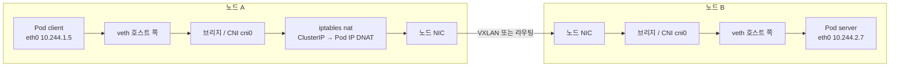

# Kubernetes 네트워크 흐름: Pod에서 다른 노드의 Pod까지

다른 노드에 있는 Pod를 Service 이름으로 부르면, 패킷은 Pod의 가상 NIC에서 나와 호스트의 veth·브리지를 지나고, kube-proxy가 만든 iptables 규칙에서 목적지가 실제 Pod IP로 바뀐 뒤 노드 사이 네트워크를 건넌다.

> 2차 저장: 이 문장은 테스트 B 에서 수정 반영 시점을 보려고 추가했다.

## 전체 흐름



## 단계별 설명

| # | 어디서 | 무슨 일이 일어나는가 |
|---|---|---|
| 1 | Pod 안 | Pod는 자기만의 네트워크 네임스페이스를 가진다. `my-svc:80`을 조회하면 CoreDNS가 ClusterIP를 돌려주고, 패킷은 `eth0`로 나간다. |
| 2 | veth 쌍 | `eth0`는 veth 쌍의 한쪽 끝이고 다른 끝은 호스트 네임스페이스에 있다. |
| 3 | 브리지 / CNI | 호스트 쪽 veth는 브리지에 붙거나 CNI가 만든 라우트로 연결된다. 같은 노드 Pod면 여기서 끝난다. |
| 4 | Service 변환 | kube-proxy가 만든 iptables(nat) 규칙의 `KUBE-SERVICES` → `KUBE-SVC-*` → `KUBE-SEP-*` 체인이 목적지를 실제 Pod IP 하나로 DNAT 한다. |
| 5 | 노드 사이 | 오버레이(VXLAN 등)로 캡슐화하거나 라우팅으로 다른 노드에 전달한다. |
| 6 | 노드 B | 디캡슐화 후 브리지·veth를 거쳐 Pod의 `eth0`에 도착한다. |
| 7 | 응답 | 노드 A의 conntrack이 DNAT 매핑을 기억해 출발 주소를 ClusterIP로 되돌린다. |

## 직접 확인하는 명령

```sh
kubectl exec -it <pod> -- ip addr show eth0
sudo iptables -t nat -L KUBE-SERVICES -n | grep <cluster-ip>
sudo conntrack -L | grep <cluster-ip>
```
