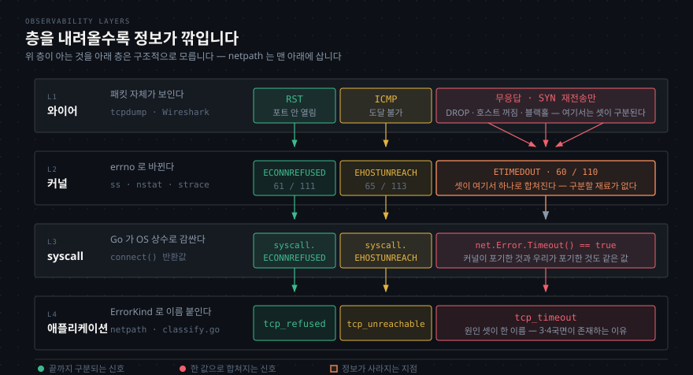

# 네트워크에서 일어난 일이 Go 에러 값이 되기까지
---

## 왜 이 경로를 알아야 하는가

> `tcp_refused` 라는 이름표는 우리가 붙인 것이지만, 그 근거는 **커널이 받은 패킷 한 장**입니다. 그 사이에 층이 넷 있고, 각 층에서 정보가 조금씩 깎입니다.



이 도구가 답해야 할 질문은 "어디서 왜 실패했는가" 인데, 우리가 손에 쥐는 건 Go 에러 값 하나입니다. **그 값이 어디서 왔고 무엇을 잃은 채로 왔는지** 알아야 무엇까지 답할 수 있는지 알 수 있습니다.


## TCP — 네트워크에서 일어난 일이 값이 되기까지

> `connect()` 시스템 콜 하나가 SYN 을 보내고, 돌아오는 것에 따라 errno 가 갈립니다.

| 실제 일어난 일 | 커널이 받은 것 | errno | Go | ErrorKind |
|---|---|---|---|---|
| 포트에 아무것도 안 듣고 있음 | RST | `ECONNREFUSED` | `syscall.ECONNREFUSED` | `tcp_refused` |
| 방화벽 `-j REJECT` | RST 또는 ICMP | `ECONNREFUSED` | 위와 같음 | `tcp_refused` |
| 라우터가 호스트 도달 불가 응답 | ICMP host unreachable | `EHOSTUNREACH` | `syscall.EHOSTUNREACH` | `tcp_unreachable` |
| 로컬에 경로 없음 | (커널 즉시 판단) | `ENETUNREACH` | `syscall.ENETUNREACH` | `tcp_unreachable` |
| 방화벽 `-j DROP` | 없음 | `ETIMEDOUT` | `net.Error.Timeout()` | `tcp_timeout` |
| 상대 호스트 꺼짐 | 없음 | `ETIMEDOUT` | 위와 같음 | `tcp_timeout` |
| 경로 중간 블랙홀 | 없음 | `ETIMEDOUT` | 위와 같음 | `tcp_timeout` |

**아래 셋이 같은 값으로 떨어집니다.** 커널이 받은 게 똑같이 "없음"이라 구분할 재료가 없습니다. 이것이 한 지점에서 재는 도구의 한계이고, 3국면(여러 노드에서 비교)과 4국면(Kubernetes 리소스를 증거로 결합)이 존재하는 이유입니다.

REJECT 와 DROP 이 갈리는 것도 여기서 나옵니다. 방화벽이 `REJECT` 면 RST 를 돌려줘 `tcp_refused` 가 되고, `DROP` 이면 침묵해서 `tcp_timeout` 이 됩니다. **Kubernetes NetworkPolicy 는 DROP 계열**이라 timeout 쪽으로 떨어집니다.


## errno 는 OS 마다 숫자도 문자열도 다릅니다

> 그래서 메시지를 매칭하면 개발 환경에서는 통과하고 운영 환경에서 조용히 깨집니다.

같은 Go 소스를 맥과 리눅스에서 돌려 재 봤습니다(2026-09-14).

| errno | 맥 값 | 리눅스 값 | 맥 문자열 | 리눅스 문자열 |
|---|---|---|---|---|
| `ECONNREFUSED` | 61 | 111 | `connection refused` | `connection refused` |
| **`ETIMEDOUT`** | **60** | **110** | **`operation timed out`** | **`connection timed out`** |
| `EHOSTUNREACH` | 65 | 113 | `no route to host` | 같음 |
| `ENETUNREACH` | 51 | 101 | `network is unreachable` | 같음 |
| `ECONNRESET` | 54 | 104 | `connection reset by peer` | 같음 |

`ETIMEDOUT` 의 **문자열이 갈립니다.** 이런 코드는 리눅스에서만 동작합니다.

```go
if strings.Contains(err.Error(), "connection timed out") { ... }   // 맥에서는 안 잡힌다
```

이 프로젝트에 특히 치명적입니다. **개발은 맥에서 하고, 3국면에서는 리눅스 컨테이너에서 돕니다.** 맥에서 맞춰 놓으면 클러스터에서 전부 `other` 로 떨어지고, 진단 도구가 진단을 멈춘 채로 계속 돕니다.

숫자도 전부 다릅니다(61 vs 111). `errors.Is(err, syscall.ECONNREFUSED)` 가 안전한 이유가 이것입니다 — **Go 가 컴파일 시점에 그 OS 의 상수로 바꿔 줍니다.** 우리는 이름만 쓰면 되고, 이름이 사라지면 컴파일이 깨져 즉시 알게 됩니다.


## 두 종류의 타임아웃이 같은 이름으로 옵니다

> 커널이 포기한 것과 우리가 포기한 것은 다른 사건인데, 둘 다 `tcp_timeout` 이 됩니다.

**커널 타임아웃** — 아무 답이 없으면 커널이 SYN 을 재전송합니다. 리눅스 기본값이 `net.ipv4.tcp_syn_retries = 6` 이라 다 소진하면 2분 남짓 걸린 뒤 `ETIMEDOUT` 이 옵니다.

**호출자 타임아웃** — `--timeout 3s` 를 걸면 3초에 `context` 데드라인이 먼저 터집니다. 커널은 아직 재전송 중인데 우리가 먼저 포기하는 것입니다.

Done Line 의 `netpath --timeout 3s http://10.255.255.1:8080` 이 3초 만에 답하는 게 두 번째 경로입니다. 커널을 기다리면 2분이 걸립니다.

둘을 굳이 안 가르는 이유는 **조치가 같기** 때문입니다. 어느 쪽이든 "아무 답이 없다"이고, 다음에 볼 것은 방화벽과 경로입니다. 분류를 늘리는 기준이 "그 구분이 다른 조치로 이어지는가" 였는데, 여기서는 이어지지 않습니다.


## 층마다 보는 것이 다릅니다

> 같은 사건을 어느 높이에서 보느냐에 따라 알 수 있는 것이 달라집니다. **netpath 는 맨 아래 층에 삽니다.**

| 층 | 보는 것 | 도구 |
|---|---|---|
| 와이어 | 패킷 자체. RST·ICMP·재전송이 눈에 보인다 | `tcpdump`, Wireshark |
| 커널 소켓 | 소켓 상태와 개수 | `ss`, `lsof` |
| 커널 카운터 | 누적 실패·재전송 통계 | `nstat`, `netstat -s` |
| syscall | `connect()` 가 돌려준 errno 원본 | `strace` |
| **애플리케이션** | **Go 에러 값** | **netpath** |

`tcpdump` 는 "SYN 을 여섯 번 보냈는데 아무것도 안 왔다"를 봅니다. 그 여섯 번이 애플리케이션에는 **하나의 타임아웃**으로 도착합니다. 위 층이 아는 것을 아래 층은 구조적으로 모릅니다.

### 증상별 확인 명령 (리눅스)

| 확인하려는 것 | 명령 | 무엇이 보이면 무엇인가 |
|---|---|---|
| refused/timeout/unreachable 판별 | `tcpdump -i any -nn host <ip> and port <port>` | SYN 뒤 **RST** 는 refused, **SYN 만 반복**은 DROP, **ICMP** 는 unreachable |
| 포트가 열려 있나 | `ss -ltnp` | LISTEN 목록에 없으면 refused 예상 |
| 연결이 어디서 멈췄나 | `ss -tan state syn-sent` | SYN-SENT 로 머물면 응답 없음 |
| REJECT 인가 DROP 인가 | `iptables -L -n -v` | 정책과 **패킷 카운터** |
| 경로가 있나 | `ip route get <ip>` | 실패하면 `ENETUNREACH` |
| errno 원본 | `strace -f -e trace=network ./netpath <url>` | `connect()` 반환값이 그대로 |

마지막 줄이 값집니다. **우리가 만드는 분류의 원재료를 눈으로 보는 명령**입니다. `net.Dial("tcp", "127.0.0.1:9")` 한 줄이 실제로 무엇을 부르는지 재면 이렇습니다.

```text
socket(AF_INET, SOCK_STREAM|SOCK_CLOEXEC|SOCK_NONBLOCK, IPPROTO_IP) = 4
connect(4, {sa_family=AF_INET, sin_port=htons(9), sin_addr=inet_addr("127.0.0.1")}, 16) = -1 EINPROGRESS
```

`strace` 에 찍히는 `-1 ECONNREFUSED` 가 `classify.go` 가 `syscall.ECONNREFUSED` 로 받는 그 값입니다.

### 자원 고갈은 다른 축입니다

| 증상 | 명령 | errno | ErrorKind |
|---|---|---|---|
| fd 한계 초과 | `ulimit -n`, `lsof -p <pid> \| wc -l` | `EMFILE` / `ENFILE` | `tcp_other` |
| 임시 포트 고갈 | `sysctl net.ipv4.ip_local_port_range`, `ss -tan state time-wait \| wc -l` | `EADDRNOTAVAIL` | `tcp_other` |

**연결 실패가 아니라 우리 쪽이 소켓을 못 연 것**입니다. 상대는 아무 잘못이 없습니다. "네트워크 경로" 축이 아니라 "호출자 상태" 축의 문제인데 지금 목록에 그 축이 없어서 `tcp_other` 로 떨어집니다. `_other` 가 대기실인 이유입니다.


## 실습 환경 — OrbStack 우분투

> 관측은 맥이 아니라 리눅스에서 합니다. 맥에는 `ss`·`ip`·`mtr` 이 없고 방화벽도 `pf` 라 다릅니다.

실측(2026-09-10): `orb list` 기준 두 대가 떠 있습니다.

| 머신 | IP | OS · 커널 |
|---|---|---|
| `ubuntu` | 192.168.139.208 | Ubuntu 26.04 LTS · 7.0.14-orbstack |
| `ubuntu2` | 192.168.139.238 | 같음 |

기본 설치: `ss` `ip` `tcpdump` `dig` `strace` `iptables` `nft` `nstat` `nc` `conntrack`.
채워야 하는 것: `sudo apt install -y lsof traceroute mtr-tiny`.

두 대로 REJECT 와 DROP 을 대조할 수 있습니다.

| 케이스 | `ubuntu2` 에 거는 설정 | 기대 신호 |
|---|---|---|
| A. 아무도 안 들음 | (설정 없음) | `tcp_refused` 즉시 |
| B. REJECT | `sudo iptables -I INPUT -p tcp --dport 8080 -j REJECT` | `tcp_refused` 즉시 |
| C. DROP | `sudo iptables -I INPUT -p tcp --dport 8080 -j DROP` | `tcp_timeout` 전체 소진 |

`ubuntu` 에서 `tcpdump -i any -nn host 192.168.139.238 and port 8080` 을 띄워 두면, A·B 는 RST 가 돌아오고 C 는 SYN 만 반복되는 것이 보입니다. **B 와 C 의 차이가 방화벽 설정 한 낱말**이라는 것도 같이 보입니다.

맥에서 같은 실습을 하려면 한 단계가 더 필요합니다. macOS 는 `127.0.0.0/8` 전체를 `lo0` 에 자동으로 붙이지 않습니다. 그래서 `127.0.0.2` 로 걸면 refused 가 아니라 **타임아웃**이 옵니다(실측 2000ms).

`sudo ifconfig lo0 alias 127.0.0.2` 로 별칭을 더해야 리눅스와 같아집니다.
