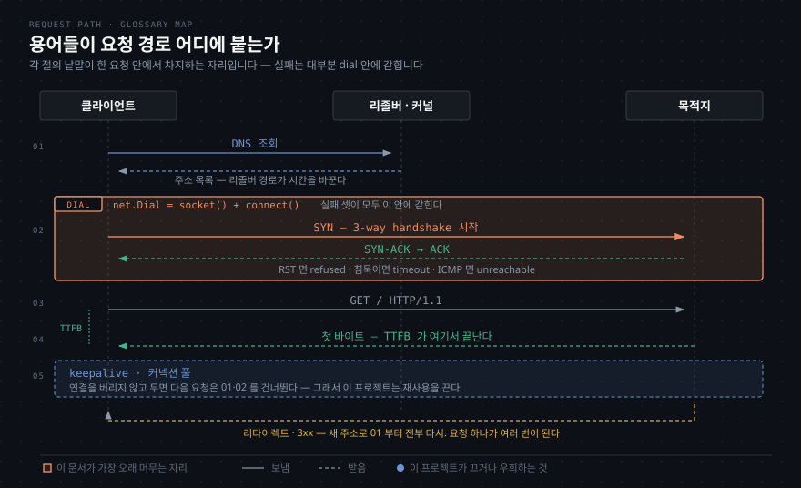

# 요청 하나가 지나가는 길의 용어들
---

## 왜 이 용어들인가

> `netpath` 는 요청 하나를 네 단계로 갈라 재는 도구입니다. 그 길에 서 있는 이름들을 모르면 측정 결과를 읽을 수 없습니다.



이 문서는 프로젝트를 만들며 마주친 용어를 모은 곳입니다. 사전처럼 한 줄로 적지 않고, **왜 알아야 하는가**와 **이 프로젝트의 어디에 걸리는가**를 함께 적습니다. 코드를 짜다 모르는 이름이 또 나오면 여기에 덧붙입니다.


## dial — 연결을 걸다

> 전화를 거는 동작에서 온 이름입니다. 주소를 받아 실제 소켓 연결을 세우는 일을 말합니다.

Go 의 `net.Dial("tcp", "93.184.216.34:443")` 은 "이 주소로 TCP 연결을 하나 세워라"는 뜻입니다. 내부에서 `socket()` 으로 소켓을 만들고 `connect()` 시스템 콜을 불러 3-way handshake 를 수행합니다.

이름이 중요한 이유는 **실패 지점이 dial 안에 갇히기** 때문입니다. `tcp_refused`·`tcp_timeout`·`tcp_unreachable` 셋 다 dial 이 돌려주는 에러입니다. 그래서 `classify.go` 가 볼 첫 대상이 dial 에러입니다.

HTTP 클라이언트에서는 `Transport.DialContext` 가 이 자리를 맡습니다. 우리가 직접 부르지 않고 클라이언트가 필요할 때 부르는데, **필요할 때가 언제인가**가 뒤에 나오는 커넥션 풀 이야기입니다.

### 소켓 API — 클라이언트와 서버는 대칭입니다

`dial` 은 Go 가 붙인 이름이고, 그 밑에는 BSD 소켓 API 가 있습니다. 1980년대 버클리 유닉스에서 나와 지금까지 네트워크 프로그래밍의 바탕입니다.

```text
서버                                  클라이언트
socket()      소켓을 만든다            socket()
bind(주소)    주소를 붙인다
listen(N)     대기줄을 만든다
accept()   ←──── 연결 요청 ────────   connect(주소)
read()/write() ←── 데이터 ──→        write()/read()
close()                               close()
```

Go 는 이 호출들을 묶어 다시 이름을 붙였습니다.

| 시스템 콜 | Go |
|---|---|
| `socket` + `connect` | **`net.Dial`** |
| `socket` + `bind` + `listen` | `net.Listen` |
| `accept` | `Listener.Accept` |
| `read` / `write` | `Conn.Read` / `Conn.Write` |
| `close` | `Conn.Close` |

`net.Dial("tcp", "127.0.0.1:9")` 한 줄이 실제로 무엇을 부르는지 리눅스에서 추적했습니다(`strace -e trace=socket,connect`).

```text
socket(AF_INET, SOCK_STREAM|SOCK_CLOEXEC|SOCK_NONBLOCK, IPPROTO_IP) = 4
connect(4, {sa_family=AF_INET, sin_port=htons(9), sin_addr=inet_addr("127.0.0.1")}, 16) = -1 EINPROGRESS
```

`socket(AF_INET, SOCK_STREAM)` 이 "IPv4 · TCP 소켓을 만들어라" 이고, 반환값 `4` 가 **파일 디스크립터**입니다. 유닉스에서 소켓도 파일처럼 번호로 다룹니다. 이어지는 `connect(4, ...)` 가 그 소켓을 목적지에 연결합니다.

`SOCK_NONBLOCK` 과 `EINPROGRESS` 는 Go 런타임의 방식입니다. **논블로킹 소켓**으로 열고 "진행 중"을 즉시 돌려받은 뒤, 완료는 epoll 로 통지받습니다. 그동안 그 goroutine 만 재우고 OS 스레드는 다른 일을 합니다. 수천 개의 연결을 스레드 수천 개 없이 다루는 방식이 이것입니다.

### `net.OpError` 의 `Op` — 무엇을 하다 실패했는가

에러 체인에서 단계를 알아내는 단서입니다. Go 소스에서 실제로 쓰이는 값을 뽑으면 열여섯 개인데, 알아 둘 것은 여섯입니다.

| `Op` | 무엇을 하다 실패했나 | 누가 하나 |
|---|---|---|
| `dial` | 연결을 걸다 | 클라이언트 |
| `listen` | 포트를 열고 기다리다 | 서버 |
| `accept` | 들어온 연결을 받다 | 서버 |
| `read` | 데이터를 읽다 | 양쪽 |
| `write` | 데이터를 쓰다 | 양쪽 |
| `close` | 닫다 | 양쪽 |

나머지(`addmulti`, `announce`, `route`, `writev`, `wsasend` 등)는 멀티캐스트·라우팅·Windows 전용 같은 변두리입니다.

그래서 우리 에러 체인에 **같은 동작의 두 이름**이 함께 나옵니다.

```text
*net.OpError{Op: "dial"}              ← Go 층의 이름
*os.SyscallError{Syscall: "connect"}  ← 시스템 콜의 이름
```

`dial` 이라는 낱말은 Plan 9 에서 왔습니다. Go 설계자들이 그쪽 출신이라 관례를 가져왔고, POSIX 세계에서는 같은 일을 `connect` 라고 부릅니다.


## DNS 리졸버 — 어느 길로 묻느냐가 시간을 바꾼다

> Go 는 이름을 주소로 바꾸는 길을 둘 갖고 있습니다. 어느 쪽을 타느냐에 따라 **같은 조회가 4ms 도 되고 112ms 도 됩니다.**

| 길 | 어떻게 묻나 |
|---|---|
| **순수 Go 리졸버** | `/etc/resolv.conf` 를 직접 읽고 네임서버로 UDP 53 질의를 보낸다 |
| **시스템 리졸버** | cgo 로 `getaddrinfo` 를 부른다. OS 의 캐시와 설정을 그대로 탄다 |

같은 대상을 세 조건으로 재 봤습니다(2026-09-14, macOS).

```bash
기본 빌드            DNS    4ms   lookup nope.invalid: no such host
CGO_ENABLED=0        DNS    2ms   lookup nope.invalid: no such host
GODEBUG=netdns=go    DNS  112ms   lookup nope.invalid on 192.168.0.1:53: no such host
```

세 번째가 둘에서 다릅니다. **메시지에 네임서버 주소가 붙고, 시간이 28배**입니다. 순수 Go 리졸버는 네임서버까지 실제로 갔다 오고, 시스템 리졸버 경로는 macOS 의 `mDNSResponder` 캐시에서 답을 받습니다.

### 분류는 안 깨지고 시간이 깨집니다

메시지가 다른데도 `*net.DNSError` 의 `IsNotFound` 는 양쪽에서 `true` 입니다. **"메시지로 분기하지 않는다"는 결정이 값을 하는 자리**입니다. 문자열을 매칭했다면 `on 192.168.0.1:53` 이 붙은 쪽에서 조용히 분류를 놓쳤을 것입니다.

깨지는 건 시간입니다. `DNS 4ms` 와 `DNS 112ms` 가 같은 대상에 대해 나옵니다.

### 측정 도구로서는 캐시를 타는 쪽이 맞습니다

우리가 재려는 건 **"요청 하나가 실제로 겪는 시간"** 이지 "네임서버의 응답 속도"가 아닙니다. 애플리케이션이 캐시 덕을 본다면 그게 실제입니다. 그래서 기본 동작을 그대로 둡니다.

다만 **무엇을 재고 있는지는 알아야** 합니다. 전환은 이렇게 합니다.

```bash
GODEBUG=netdns=go    netpath http://example.com   # 순수 Go 리졸버 강제
GODEBUG=netdns=cgo   netpath http://example.com   # 시스템 리졸버 강제
GODEBUG=netdns=2     netpath http://example.com   # 어느 쪽을 골랐는지 stderr 에 찍는다
CGO_ENABLED=0 go build ./cmd/netpath              # 빌드 단계에서 순수 Go 만 남긴다
```

`make build` 가 `CGO_ENABLED=0` 을 씁니다. 다만 macOS 에서 그것만으로 경로가 완전히 고정되는지는 확인하지 않았습니다 — 위 실측에서 두 번째 줄이 2ms 였던 걸 보면 여전히 캐시를 타는 것으로 보입니다.

### 3국면에서 다시 걸립니다

클러스터 안에서 재는 값과 맥에서 재는 값이 다를 수 있습니다.

**distroless 이미지에는 시스템 리졸버가 없습니다.** libc 조차 없으므로 `CGO_ENABLED=0` 정적 바이너리를 넣어야 하고, 그러면 순수 Go 리졸버만 남습니다. 캐시도 없습니다. 같은 대상이 노트북에서 4ms, Pod 에서 100ms 로 나와도 그건 네트워크가 아니라 **리졸버 경로의 차이**일 수 있습니다.

그리고 Pod 의 `/etc/resolv.conf` 에는 `ndots:5` 가 들어갑니다. 점이 다섯 개 미만인 이름을 조회하면 search domain 을 먼저 다 시도하므로, 성공하는 조회에도 실패 질의가 여러 번 앞섭니다.

```text
example.com.default.svc.cluster.local   NXDOMAIN
example.com.svc.cluster.local           NXDOMAIN
example.com.cluster.local               NXDOMAIN
example.com                             성공
```

이건 `dns_*` 오류가 아니라 **DNS 단계의 지연**으로 나타납니다. `ErrorKind` 를 늘릴 자리가 아니라 "질의를 몇 번 했나"를 기록할 자리인데, `tcp.attempts` 와 같은 축입니다.


## handshake — 시작과 끝의 합의

> 연결을 세울 때도, 정상적으로 끊을 때도 양쪽이 정해진 패킷을 주고받습니다. 그 절차를 handshake 라고 합니다.

세울 때는 세 장(3-way)입니다.

```text
클라이언트                          서버
    |-------- SYN ------------------>|   "연결하고 싶다"
    |<------- SYN-ACK ---------------|   "좋다"
    |-------- ACK ------------------>|   "그럼 시작"
  ===== 여기서 ESTABLISHED =====
```

정상적으로 끊을 때는 네 장(4-way)입니다. `FIN` 을 주고받으며 **양쪽이 각자 "더 보낼 것 없다"를 선언**합니다. 한쪽이 먼저 끝내도 다른 쪽은 계속 보낼 수 있어서 두 방향을 따로 닫습니다.

```text
    |-------- FIN ------------------>|   "보낼 것 끝"
    |<------- ACK -------------------|
    |<------- FIN -------------------|   "나도 끝"
    |-------- ACK ------------------>|
```

**RST 는 handshake 가 아닙니다.** 한 장으로 끝나는 통보이고, 협상이 없으며, 버퍼에 남은 데이터를 버립니다.

```text
    |<------- RST -------------------|   "이 연결은 없는 것으로"
```

같은 RST 인데 **언제 오느냐로 뜻이 갈립니다.** 첫 SYN 에 대한 RST 는 "그 포트에 아무것도 없다"(`tcp_refused`)이고, ESTABLISHED 뒤의 RST 는 "있던 연결이 무효가 됐다"(`ECONNRESET`)입니다.

연결 후 RST 가 나오는 원인 중 **프로세스가 죽는 경우가 가장 흔합니다.** 커널이 그 프로세스의 소켓을 정리하면서 상대에게 RST 를 보냅니다. Kubernetes 에서 Pod 가 종료될 때 앱이 연결을 닫지 않고 죽으면 이 경로를 탑니다. 그다음으로 흔한 것이 로드밸런서의 idle timeout 입니다 — LB 가 세션 테이블에서 연결을 지운 뒤, 클라이언트가 그 연결로 패킷을 보내면 LB 가 RST 로 답합니다.


## keepalive 와 커넥션 풀 — 연결을 버리지 않고 두는 것

> 연결 하나를 세우는 데 왕복이 여러 번 듭니다. 그래서 HTTP 클라이언트는 다 쓴 연결을 버리지 않고 모아 두었다가 다음 요청에 다시 씁니다.

요청 세 개를 같은 서버로 보낼 때 두 방식의 차이가 이렇습니다.

```text
[ 매번 새로 연결 ]                    [ 연결을 재사용 ]

요청 1                                요청 1
  dial (SYN·SYN-ACK·ACK)                dial (SYN·SYN-ACK·ACK)
  TLS handshake                         TLS handshake
  GET / ... 200                         GET / ... 200
  close (FIN 4장)                       연결을 풀에 넣어 둔다
                                             |
요청 2                                요청 2  |
  dial                                  풀에서 꺼낸다  <---+
  TLS handshake                         GET / ... 200
  GET / ... 200                         다시 풀에
  close                                      |
                                      요청 3  |
요청 3                                  풀에서 꺼낸다  <---+
  dial                                  GET / ... 200
  TLS handshake
  GET / ... 200
  close
```

오른쪽은 dial 과 TLS handshake 를 **한 번만** 합니다. TLS 는 왕복이 한두 번 더 드니 절약이 큽니다. 그래서 이게 기본 동작입니다.

Go 에서 이 풀은 **`http.Transport` 가 직접 관리합니다.** 우리가 만들거나 관리하지 않습니다. `Transport` 안에 유휴 연결 맵이 있고, 요청이 오면 "이 호스트로 쓸 수 있는 유휴 연결이 있나"를 먼저 봅니다.

관리 규칙이 몇 가지 있습니다.

| 설정 | 뜻 | 기본값 |
|---|---|---|
| `MaxIdleConns` | 전체 유휴 연결 수 상한 | 100 |
| `MaxIdleConnsPerHost` | 호스트별 유휴 연결 수 상한 | 2 |
| `IdleConnTimeout` | 이 시간 동안 안 쓰이면 닫는다 | 90초 |
| `DisableKeepAlives` | 재사용을 아예 끈다 | false (재사용함) |

`MaxIdleConnsPerHost` 가 2 라는 점을 알아 둘 만합니다. 한 호스트로 동시에 요청을 많이 보내면 세 번째부터는 풀에 못 들어가고 닫힙니다. 부하가 큰 서비스에서 이 값을 올리는 것이 흔한 튜닝입니다.

### 이 프로젝트에서는 재사용을 끕니다

측정이 사라지기 때문입니다. **재사용된 연결은 dial 과 handshake 를 건너뜁니다.** 건너뛴 단계는 `httptrace` 훅이 불리지 않아서, 두 번째 프로브의 결과가 이렇게 됩니다.

```text
DNS           -  실행되지 않음
TCP           -  실행되지 않음      ← 12ms 가 아니라 "없음"
TLS           -  실행되지 않음
HTTP       40ms  성공
```

그래서 `DisableKeepAlives = true` 를 켭니다. 매번 새로 연결하면 느리지만, **우리 목적은 빠른 요청이 아니라 정확한 측정**입니다.

`Result` 의 `reused` 필드가 이 사실을 기록합니다. `true` 면 재사용된 연결이라 TCP·TLS 측정이 없다는 뜻이고, 우리는 항상 `false` 여야 합니다. **재사용 차단이 실제로 걸렸는지 확인하는 근거**라서 `omitempty` 를 붙이지 않았습니다.

그리고 재사용을 끄면 부수적으로 하나를 더 피합니다. 위에서 본 LB idle timeout 문제 — 풀에 있던 연결이 상대편에서 이미 끊겼는데 그걸 모르고 쓰는 상황이 생기지 않습니다.


## TTFB — 첫 바이트까지의 시간

> Time To First Byte. 요청을 다 보낸 시점부터 응답의 **첫 바이트**가 도착할 때까지의 시간입니다.

응답을 다 받은 시간이 아니라는 게 핵심입니다. 한 요청의 시간을 이렇게 자를 수 있습니다.

```text
  |--- dial ---|--- TLS ---|--- 요청 write ---|--- 대기 ---|--- 본문 수신 ---|
                                              ^           ^
                                       요청 전송 완료   첫 바이트 도착
                                              |<-- TTFB -->|
```

TTFB 가 무엇을 재는지 보면 쓸모가 드러납니다. 요청은 이미 다 갔고 응답은 아직 안 왔으니, **그 사이는 서버가 일한 시간**입니다. 서버가 DB 를 조회하고 렌더링하는 시간이 여기 들어갑니다.

그래서 진단이 갈립니다. TTFB 가 길면 서버가 느린 것이고, TTFB 는 짧은데 전체가 길면 응답 본문을 내려받는 경로가 느린 것입니다(대역폭, MTU 문제, 큰 응답).

Go 에서는 `httptrace` 의 `GotFirstResponseByte` 훅이 이 시점을 알려줍니다. 우리가 HTTP 단계의 끝으로 삼는 지점이기도 합니다. 지금 설계에서는 **HTTP 단계 하나에 요청 write·대기·첫 바이트가 다 들어 있어서**, 위 그림의 구분을 아직 못 합니다. `WroteRequest` 훅을 더 쓰면 나눌 수 있고, 그게 확장 후보입니다.


## 리다이렉트 — 한 번의 요청이 여러 번이 되는 것

> 서버가 "여기 아니고 저기로 가라"고 답하면 클라이언트가 새 요청을 보냅니다. 프로브 하나가 요청 여럿이 되는 지점입니다.

서버는 `3xx` 상태 코드와 `Location` 헤더로 이걸 말합니다.

```text
클라이언트                                  서버
    |--- GET http://example.com/ ---------->|
    |<-- 301 Moved Permanently -------------|
    |    Location: https://example.com/     |
    |                                       |
    |--- GET https://example.com/ --------->|   ← 새 요청. dial·TLS 를 다시 한다
    |<-- 200 OK ----------------------------|
```

왜 생기냐면, **주소는 바뀌는데 옛 주소로 온 사람을 버릴 수는 없기** 때문입니다. 흔한 이유가 넷입니다.

| 이유 | 예 |
|---|---|
| HTTP 를 HTTPS 로 올림 | `http://` 로 오면 `https://` 로 보냄. 가장 흔함 |
| 정규 주소로 모음 | `example.com` 을 `www.example.com` 으로 (또는 반대로) |
| 주소 체계가 바뀜 | 옛 URL 을 새 URL 로 |
| 로그인 유도 | 인증 없이 접근하면 로그인 페이지로 |

Go 의 `http.Client` 는 기본으로 리다이렉트를 **따라갑니다. 최대 10회**입니다. 초과하면 에러가 납니다.

측정하는 쪽에서는 이게 문제가 됩니다. `http://example.com` 을 재면 실제로는 요청이 두 번 나가고, 두 번째 요청에서 **dial 과 TLS handshake 가 다시 일어납니다.** 그러면 `httptrace` 훅이 두 벌 불리고, 우리 수집기는 나중 것으로 앞의 것을 덮어씁니다.

즉 **"1 probe = 1 trace" 라는 전제가 리다이렉트에서 깨집니다.** 지금은 이 사실을 아는 것까지만 하고, 실제 처리는 6단계에서 훅이 여러 번 불리는 경우를 다룰 때 함께 봅니다.


## 프록시와 터널 — 남의 연결 안에 내 연결을 넣는 것

> 프록시를 거쳐 HTTPS 로 나갈 때, 프록시와 먼저 연결을 세운 뒤 **그 연결 안에서** 목적지와 TLS 를 합니다. 안쪽 연결을 터널이라고 부릅니다.

평문 HTTP 라면 프록시가 내용을 읽고 대신 요청해 줄 수 있습니다. 그런데 HTTPS 는 프록시가 내용을 읽으면 안 됩니다 — 읽을 수 있으면 암호화가 의미를 잃습니다. 그래서 절차가 달라집니다.

```text
클라이언트              프록시                      목적지
    |                     |                          |
    |-- CONNECT --------->|                          |   "example.com:443 으로 길을 열어라"
    |   example.com:443   |                          |
    |                     |--- TCP 연결 ------------->|
    |<-- 200 Connection --|                          |   "열었다"
    |    Established      |                          |
    |                     |                          |
    |=== 여기부터 프록시는 바이트를 그냥 전달만 한다 ===|
    |                     |                          |
    |------- TLS handshake (프록시를 통과) ---------->|
    |------- GET / (암호화됨) ----------------------->|
```

`CONNECT` 로 길을 연 뒤, 프록시는 **양쪽 바이트를 그대로 옮기는 파이프**가 됩니다. 안을 못 봅니다. 클라이언트는 목적지와 직접 TLS 를 하고, 프록시는 암호문만 나릅니다.

**터널은 이 "남의 연결 속을 지나가는 내 연결"을 부르는 말입니다.** 일반적인 뜻으로는 어떤 프로토콜을 다른 프로토콜 안에 실어 보내는 것 전부를 가리킵니다 — VPN 도, SSH 포트 포워딩도, WireGuard 도 같은 이름을 씁니다.

이 프로젝트에서 왜 아느냐면, **프록시를 거치면 단계가 하나 늘기** 때문입니다. 지금 네 단계는 프록시 없는 직접 연결을 전제합니다. 프록시가 있으면 "프록시까지의 TCP"와 "터널 수립(CONNECT)"이 앞에 붙고, 우리가 재는 TCP·TLS 는 그 뒤의 것이 됩니다. 사내망에서 프록시를 통과해 측정할 일이 생기면 그때 열 자리입니다.


## 포트 9 — 아무도 듣지 않는 것이 보장된 자리

> `http://127.0.0.1:9` 가 테스트 대상인 이유는, 그 포트에 무언가 떠 있을 가능성이 사실상 없기 때문입니다.

9번은 **discard** 서비스에 배정된 포트입니다(RFC 863). 받은 데이터를 그냥 버리는 서비스인데, 쓸 곳이 없어서 요즘 시스템에는 거의 켜져 있지 않습니다.

`tcp_refused` 를 재현하려면 **확실히 닫힌 포트**가 필요합니다. 임의로 `8080` 을 골랐다가 마침 개발 서버가 떠 있으면 테스트가 조용히 다른 것을 재게 됩니다. 9번은 배정은 되어 있고 실제로는 안 쓰이는 자리라, 이 용도로 관례처럼 쓰입니다.

`127.0.0.1` 을 쓰는 것도 같은 이유입니다. 루프백이라 네트워크를 타지 않아서 방화벽이나 경로 문제가 끼어들 여지가 없습니다. 커널이 즉시 RST 를 돌려주니 **1ms 미만에 결과가 나옵니다.** 그래서 `tcp_refused` 의 "즉시"라는 성질까지 함께 확인됩니다.
